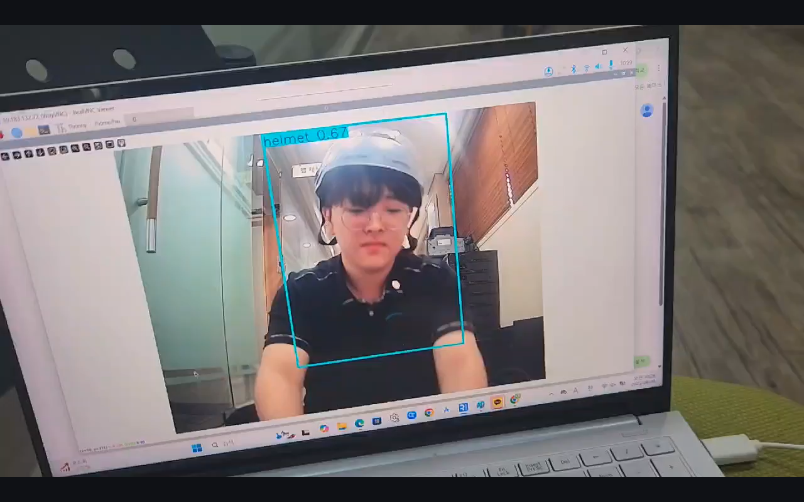
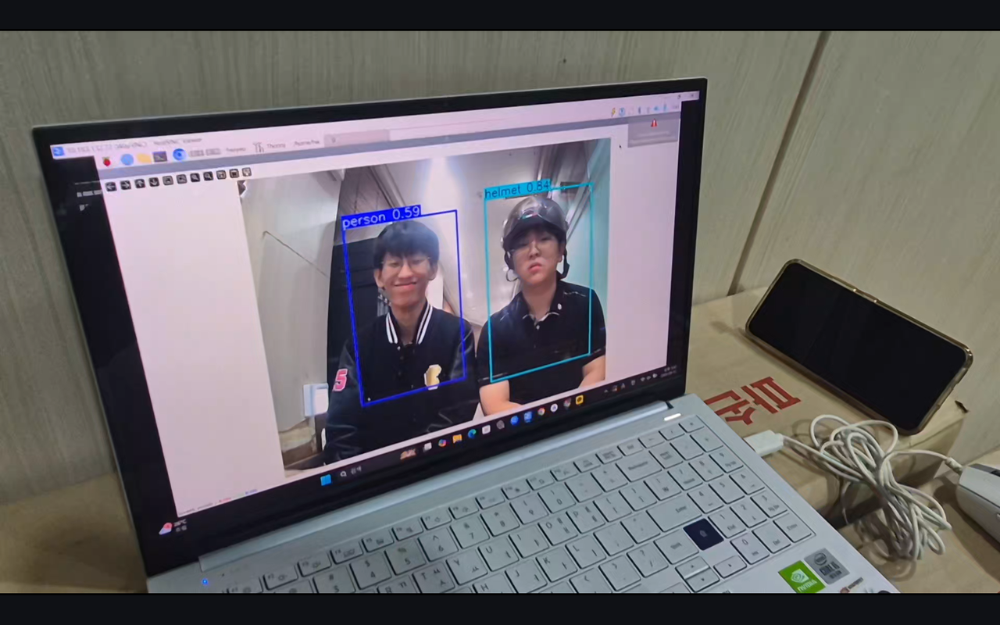
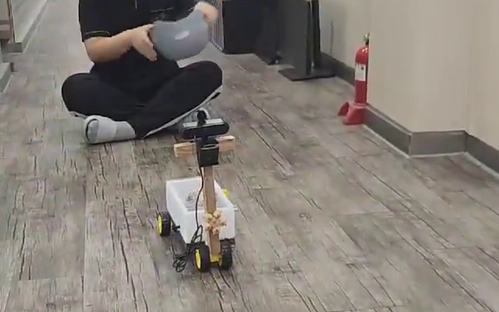
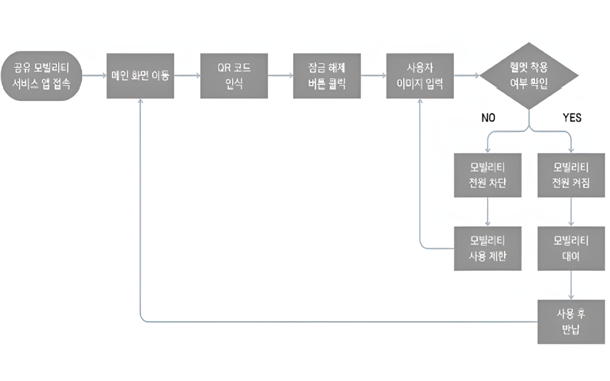

# 🛴 헬멧 인식 AI 스마트 킥보드 안전 시스템

> 🏆 제19회 서울시 직업계고 창의아이디어 경진대회 **동상** (서울시교육청, 2025.11.03)
> 🏆 교내 창의 아이디어 대회(2인) **최우수상 (1위)** (2025.07.21)
> 📄 특허 **출원** 10-2026-0167422 「인공지능 기반 공유 모빌리티 안전 제어 시스템 및 방법」
>
> 공유 전동 킥보드 이용자의 **헬멧 착용 여부와 다인(2인 이상) 탑승을 카메라로 실시간 인식**해, 위험 상태면 전원을 차단하거나 서행 후 정지시키는 안전 제어 시스템입니다.

> [!NOTE]
> 이 레포지토리에는 **소스코드가 없습니다.** 2025년 대회 당시 코드를 깃허브나 백업에 남겨두지 않아서, 발표 자료·연구계획서·시연 영상으로 남은 기록을 정리한 **문서 아카이브**입니다.
> 코드를 남기지 않은 것 자체가 이 프로젝트에서 가장 크게 배운 점이라, 숨기지 않고 그대로 적었습니다. (→ [7. 배운 점](#7-배운-점--다음에-개선할-점))

---

## 1. 한 줄 소개

카메라로 헬멧을 썼는지, 두 명이 같이 탔는지를 보고 킥보드 전원을 제어하는 AI 시스템입니다.

| | |
|---|---|
| 📅 기간 | 2025.06 ~ 2025.11 (아이디어 도출 → 교내 예선 → 본선 → 결선) |
| 👥 인원 | 학생 2명 (박시우, 조휘연) + 지도교사 1명 |
| 🧑‍💻 내 역할 | **팀장 / 인공지능 개발 / 발표자료·킥보드 모형 제작** |

**내가 맡은 일**

- 팀장으로 일정과 역할 분담 관리, 예선 발표 진행(대본 앞 절반 담당)
- 헬멧 인식 모델 학습용 데이터 수집·라벨링과 모델 학습 (팀원과 공동 작업)
- 학습한 모델을 라즈베리파이에 올리고 카메라로 실시간 추론되게 연결
- 킥보드 모형 제작 (목재·아크릴판 재단, 배선, 라즈베리파이·카메라 장착)
- 예선/본선/결선 발표자료 제작, 특허 출원 서류 작성 (지분 70%, 대표자)

---

## 2. 사용 기술


| 분류 | 사용한 것 |
|---|---|
| 모델 | **YOLO 기반** 객체 탐지 (helmet / not_helmet / person 3클래스) |
| 보드 | Raspberry Pi + USB 카메라 모듈 |
| 개발 환경 | Python, Thonny (라즈베리파이), RealVNC Viewer로 원격 접속 |
| 하드웨어 | 목재·아크릴판(10T) 재단 모형, 18650 배터리, 모터 |

> 예선 단계에서는 Keras CNN(`best_model.keras`) + OpenCV로 만들었고, 본선·결선에서는 YOLO 기반 객체 탐지로 바꿨습니다.
> **YOLO 세부 버전은 당시 발표자료에 적어두지 않아 확실하지 않아서 적지 않았습니다.** mAP·정확도·라즈베리파이 FPS도 **별도로 측정하지 않았습니다.**

---

## 3. 왜 만들었나

- 공유 킥보드 이용자가 늘면서 사고와 사상자도 같이 늘고 있는데, 가장 큰 원인이 **헬멧 미착용**입니다. 도로교통법 제50조 제3항으로 헬멧 착용이 의무화됐지만 실제로 쓰는 사람은 거의 없어서, 법만으로는 안 된다고 생각했습니다.
- 기존 서비스를 찾아보니 **대여 시점에 한 번 확인하고 끝**이었습니다. ALPACA는 사용자가 올린 헬멧 사진을 확인하고 포인트를 주는 방식, 뉴런 모빌리티는 헬멧의 압력 센서·턱끈 스위치를 쓰는 방식인데, 둘 다 **주행 중에는 확인을 못 하고** 헬멧을 벗어버리면 막을 방법이 없습니다.
- 그래서 "확인만 하는" 게 아니라 **실제로 킥보드 전원을 제어**하는 쪽으로 방향을 잡았습니다. 작년에 같은 아이디어를 기획만 하고 구현을 못 해서 아쉬웠는데, 이번에는 모형까지 만들어서 동작시키는 걸 목표로 했습니다.

---

## 4. 어떻게 해결했나

### ① 대여 시 헬멧 판별 → 전원 공급 제어

카메라로 이용자를 인식해서 **헬멧을 쓴 경우에만 킥보드에 전원을 공급**합니다. 미착용이면 전원이 들어오지 않아 대여 자체가 안 됩니다. 단순히 "경고"하는 게 아니라 못 타게 만드는 것이 기존 서비스와의 가장 큰 차이입니다.

### ② 주행 중 실시간 인식 → 서행 후 정지

대여할 때만 확인하면 타다가 헬멧을 벗는 걸 막을 수 없어서, 주행 중에도 계속 인식하게 했습니다.
이때 **미착용을 감지해도 바로 전원을 끊지 않습니다.** 달리는 중에 전원이 갑자기 끊기면 탑승자가 앞으로 튕겨 나가 2차 사고가 납니다. 그래서 **단계적으로 속도를 줄인 뒤 정지**하도록 설계했고, 이 "서행 후 정지" 로직을 특허 출원서에도 독창적인 요소로 적었습니다.

### ③ 다인(2인 이상) 탑승 감지

결선 준비 때 추가한 기능입니다. `person` 클래스로 **화면에 잡힌 사람 수를 세서 2명 이상이면 전원을 차단**하고, 주행 중에 감지되면 똑같이 서행 후 정지시킵니다. 하중 센서로 2인 탑승을 재는 방식은 짐을 실어도 오작동하고 우회도 쉬운데, 영상으로 세면 그 문제가 줄어든다고 봤습니다.

자세한 동작 흐름은 [docs/architecture.md](docs/architecture.md), 학습 데이터 구성은 [docs/dataset.md](docs/dataset.md)에 정리했습니다.

---

## 5. 실행 화면

| | |
|---|---|
|  |  |
| **① 헬멧 착용 인식** — 라즈베리파이에 올린 모델을 RealVNC로 원격 접속해 확인한 화면. 헬멧을 쓴 사람을 `helmet`으로 잡아냅니다. | **② 다인 탑승 인식** — 두 명이 동시에 잡힌 장면. 왼쪽은 `person`, 오른쪽은 `helmet`으로 각각 인식돼 "2명 이상"을 판별할 수 있습니다. |
|  |  |
| **③ 직접 만든 킥보드 모형** — 목재·아크릴로 만든 모형에 카메라를 핸들 위에 달고, 아래 박스에 배터리와 제어부를 넣었습니다. 헬멧을 벗으면 서행 후 정지하는 걸 시연했습니다. | **④ 시스템 플로우차트** — 앱 접속 → QR 인식 → 사용자 이미지 입력 → 헬멧 착용 여부 판별 → 전원 공급 / 차단. |

> 시연 영상에 나오는 얼굴은 저와 팀원 본인이며, 공개에 동의한 사진입니다. 학습 데이터에 쓴 제3자 사진은 초상권 문제로 이 레포에 올리지 않았습니다.

---

## 6. 어려웠던 점과 해결 과정

**팀장으로서 팀원을 이끄는 게 가장 어려웠습니다.**
6월 말에 아이디어를 내고 8월 중순까지 모델 학습, 모형 제작, 발표자료를 전부 끝내야 했는데, 둘 다 하드웨어가 처음이라 어디서부터 손대야 할지 몰라 초반에 시간을 많이 버렸습니다. 그래서 "AI 개발 → 라즈베리파이 탑재 → 모형 제작 → 결합" 4단계로 일을 쪼개고, 인공지능 개발은 둘이 같이 하되 라즈베리파이 탑재와 발표는 제가, 시각 자료는 팀원이 맡고, 모형 제작은 함께 하는 식으로 역할을 나눴습니다. 그래도 제가 다 하는 게 빠르다는 생각이 들 때가 있었는데, 그렇게 하면 팀원이 할 게 없어져서 일부러 작업을 넘기고 기다리는 연습을 했습니다.

**하드웨어가 전부 처음이었습니다.**
목재·아크릴판 커팅, 배선, 모터 연결까지 직접 해본 게 처음이라 모형 제작에만 2주 넘게 걸렸습니다. 전자·하드웨어 부분은 대학생 멘토에게 지도를 받으면서 진행했습니다.

**급정거가 더 위험하다는 걸 뒤늦게 깨달았습니다.**
처음 설계는 "미착용이면 즉시 전원 차단"이었는데, 그러면 달리던 킥보드가 갑자기 멈춰서 탑승자가 튕겨 나갑니다. 안전하려고 만든 시스템이 사고를 만드는 셈이라, 7월 1일에 **서행 후 정지**로 설계를 바꿨습니다. 결과적으로 이게 다른 서비스와 구분되는 핵심 기능이 됐고 특허 출원 내용에도 들어갔습니다.

**인식 오류를 완전히 없애지 못했습니다.**
모자나 헬멧과 비슷하게 생긴 물건을 썼을 때를 대비해 `not_helmet` 클래스를 따로 만들어 학습시켰지만, 데이터가 240장뿐이라 각도나 조명이 달라지면 신뢰도가 뚝뚝 떨어졌습니다. 예선 제안서의 SWOT에도 "헬멧 인식 오차"를 약점으로, "AI 인식 오류로 인한 책임 문제"를 위협으로 직접 적었습니다. 대회 기간 안에 해결하지는 못했습니다.

---

## 7. 배운 점 / 다음에 개선할 점

**배운 점**

- 계속 팀장과 회장을 맡다 보니 **리더로서 해야 할 일**이 무엇인지 배웠습니다. 혼자 다 하는 게 아니라, 할 일을 쪼개서 나눠주고 마감을 관리하고, 팀원이 막힌 부분을 먼저 물어봐 주는 게 팀장의 일이라는 걸 이 대회에서 제대로 느꼈습니다.
- 아이디어만 있던 작년과 달리 **실제로 만들어서 움직이는 걸 보여주는 것**의 무게를 알았습니다. 모형이 실제로 서행하다 멈추는 걸 보여주니 발표의 설득력이 완전히 달라졌습니다.
- 안전 시스템은 **"막는 것"보다 "어떻게 막느냐"가 더 중요**하다는 걸 배웠습니다. 즉시 차단이 오히려 사고를 만든다는 걸 겪으면서, 기능을 넣기 전에 그 기능이 실패했을 때 무슨 일이 벌어지는지를 먼저 생각하게 됐습니다.
- 특허 출원 서류를 직접 쓰면서 내 아이디어가 기존 기술과 무엇이 다른지 문장으로 설명하는 법을 배웠습니다.

**개선할 점**

- **코드를 남기지 않았습니다.** 이게 제일 큰 실수입니다. 라즈베리파이 SD카드와 개인 노트북에만 있던 코드가 지금은 없어서, 이 레포가 문서 아카이브가 됐습니다. 이 일 이후로는 작은 프로젝트라도 깃허브에 먼저 올리고 시작합니다.
- **성능을 전혀 측정하지 않았습니다.** mAP, precision/recall, 라즈베리파이에서의 FPS를 하나도 기록하지 않아서 "잘 된다"는 말밖에 할 수가 없습니다. 지금이라면 테스트셋을 분리하고 혼동행렬부터 뽑았을 것입니다.
- **데이터 240장은 너무 적습니다.** 조명·각도·배경이 비슷한 사진이 많아서 실제 도로 환경에서는 거의 작동하지 않았을 겁니다. 야간·우천·역광 데이터와 다양한 헬멧 종류를 모았어야 했습니다.
- **우회(spoofing)를 전혀 고려하지 않았습니다.** 지금 보안 쪽을 공부하면서 다시 보니, 카메라 앞에 헬멧 쓴 사진을 들어 보이기만 해도 뚫릴 구조입니다. 실제 서비스라면 라이브니스 검사나 다중 센서 교차 검증이 반드시 필요합니다.
- **얼굴 영상을 다루는데 개인정보 처리를 생각하지 않았습니다.** 카메라가 이용자 얼굴을 계속 찍는 시스템인데, 영상을 어디서 처리하고 저장하는지(온디바이스 처리, 즉시 폐기 등)를 설계에 넣지 않았습니다. 다음에 비슷한 걸 만든다면 이 부분을 가장 먼저 정하고 시작하겠습니다.

---

## 레포 구성

```
README.md
assets/     실행 화면·모형·플로우차트 이미지 4장
docs/
  architecture.md   시스템 구조와 동작 흐름
  dataset.md        학습 데이터 구성
  patent.md         특허 출원 정보
```
