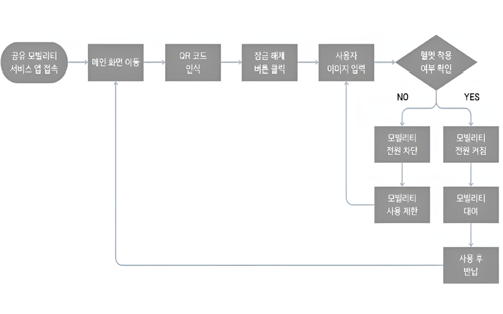

# 시스템 구조

## 1. 전체 흐름



공유 모빌리티 앱에서 출발하는 전체 흐름입니다. (예선 발표자료 기준)

1. 공유 모빌리티 서비스 앱 접속
2. 메인 화면 → **QR 코드 인식** → 잠금 해제 버튼 클릭
3. **사용자 이미지 입력** (카메라로 촬영)
4. **헬멧 착용 여부 확인**
   - **YES** → 모빌리티 전원 켜짐 → 대여 → 사용 후 반납
   - **NO** → 모빌리티 전원 차단 → 사용 제한 → 다시 이미지 입력 단계로

대여 이후에도 킥보드 전방 상단에 달린 카메라가 계속 촬영하면서 실시간으로 판별합니다. 주행 중에 헬멧 미착용이나 2인 이상 탑승이 감지되면 **즉시 멈추지 않고 서행한 뒤 정지**합니다.

## 2. 하드웨어 구성

| 번호 | 구성 요소 | 역할 |
|---|---|---|
| 카메라 | 킥보드 전방 상단에 장착한 카메라 모듈 | 인식 범위를 실시간 촬영 |
| 라즈베리파이 | 영상 수신 + AI 추론 | 헬멧 착용 / 다인 탑승 판단 |
| 컨트롤러 | 라즈베리파이의 제어 신호 수신 | 모터로 가는 전력을 제어 |
| 모터 | 구동부 | 전력 공급 여부에 따라 구동 / 감속 / 정지 |

킥보드 모형은 목재(210×410mm)와 아크릴판(10T, 200×415mm)으로 직접 재단해 만들었고, 18650 배터리(2600mAh)와 라즈베리파이를 하판 박스 안에 넣었습니다.

## 3. 판단 로직

```
카메라 영상 획득
      │
      ▼
라즈베리파이에서 추론 (YOLO 기반, 3클래스)
      │
      ├─ helmet 1명만 감지 ────────────▶ 구동 승인  → 모터에 전력 공급
      │
      ├─ not_helmet / person(헬멧 없음) ─▶ 구동 제한
      │                                    ├ 대여 전 : 전원 차단
      │                                    └ 주행 중 : 서행 후 정지
      │
      └─ person 2명 이상 감지 ──────────▶ 구동 제한
                                           ├ 대여 전 : 전원 차단
                                           └ 주행 중 : 서행 후 정지
```

### 왜 "서행 후 정지"인가

주행 중에 전원을 즉시 끊으면 킥보드가 급정거하면서 탑승자가 앞으로 튕겨 나갑니다. 안전을 위한 기능이 오히려 2차 사고를 만드는 셈입니다. 그래서 위험 상태를 감지하면 바로 끊지 않고 **단계적으로 감속한 뒤 정지**시키도록 설계했고, 이 부분을 특허 출원서에도 핵심 요소로 기재했습니다.

## 4. 기존 서비스와의 비교

| | ALPACA | 뉴런 모빌리티 | 이 프로젝트 |
|---|---|---|---|
| AI 기반 인식 | O (업로드 사진) | X (압력 센서·턱끈 스위치) | O (실시간 영상) |
| 전원 공급 제어 | X | X | **O** |
| 주행 중 실시간 분석 | X | X | **O** |
| 미착용 시 운행 중단 | X | X | **O (서행 후 정지)** |
| 다인 탑승 감지 | X | X | **O** |

## 5. 기록하지 않은 것

- YOLO의 **세부 버전**은 당시 자료에 적어두지 않아 확실하지 않습니다.
- 추론 **FPS, mAP, precision/recall**은 **별도로 측정하지 않았습니다.**
- 전원 제어에 쓴 릴레이/모터 드라이버의 정확한 부품명도 기록으로 남기지 않았습니다.

(출처: 본선 연구계획서, 결선 참가서, 결선 발표자료, 특허 발명설명서)
